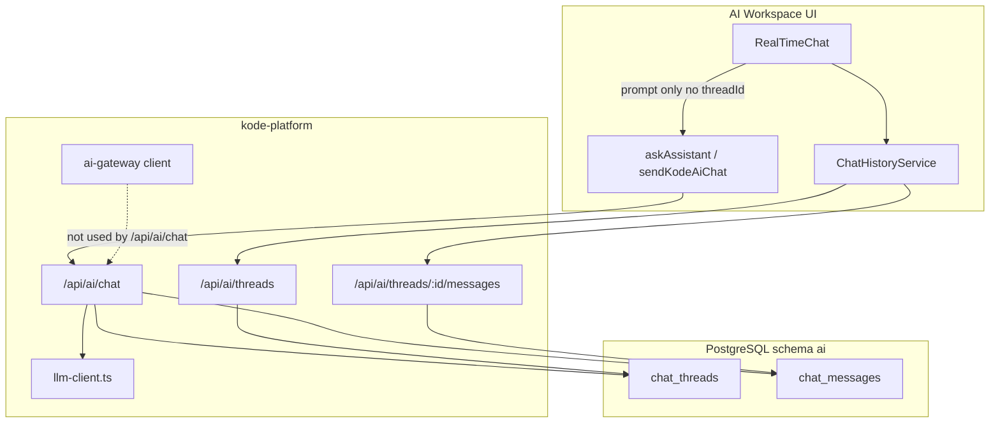
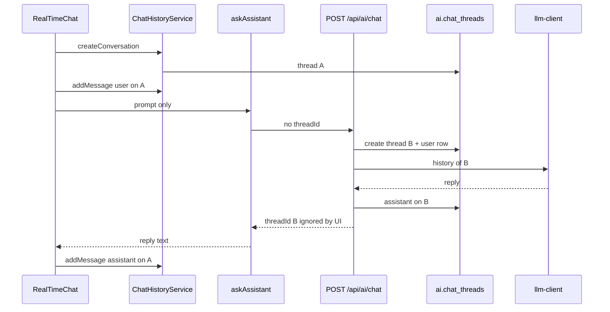
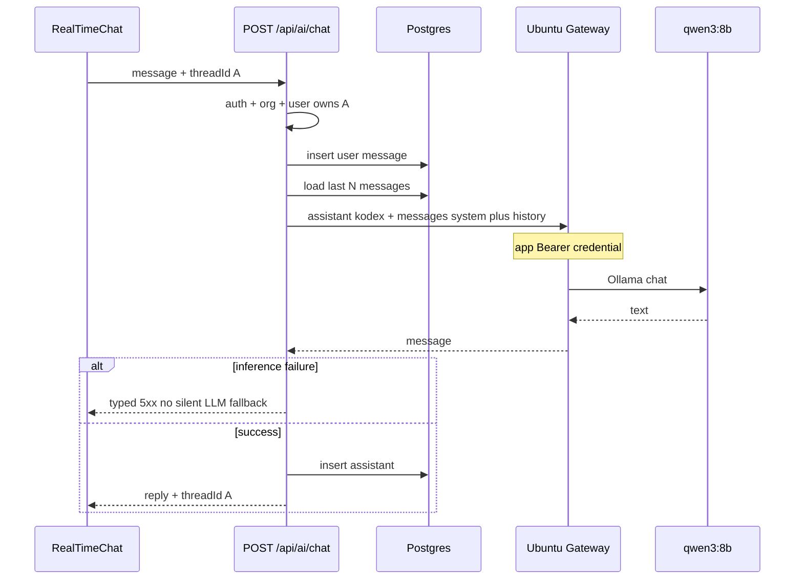

# KODEX AI Workspace conversation architecture (sprint v0.6E Phase A)

Read-only investigation. No source, schema, credential, CDN, or production changes. Content Studio analyze-media (v0.6C) is out of scope and must stay on the existing vision path.

Ubuntu chat/vision smokes and Content Studio mapping were verified in earlier sprints. This document does not repeat live inference or print conversation contents.

## 1. Executive summary

AI Workspace (`/ai-workspace`) already has **two persistence layers that are not the same conversation**:

1. **UI thread** — when Kode AI is enabled (`isKodeAiEnabled()`, true whenever Kode auth is on), `ChatHistoryService` creates and lists PostgreSQL `ai.chat_threads` / `ai.chat_messages` via `/api/ai/threads*`.
2. **Inference thread** — `POST /api/ai/chat` creates or continues a Postgres thread, loads history, and calls the OpenAI-compatible `llm-client` (`LLM_*` / `OPENAI_*`).

On the **AI Workspace** send path, those IDs **diverge**. `RealTimeChat` creates thread A and stores user/assistant copies on A, but `onAsk` → `askAssistant` → `postToInternalAiAssistance` calls `sendKodeAiChat` **without** `threadId` / `conversationId`. Each prompt therefore creates **thread B** for the LLM. The sidebar can show a long chat; Qwen (or the current LLM) still sees a **new, nearly empty** thread.

The thinner **AI Assistant** page (`AiChatPanel`) **does** pass `conversationId` into `sendKodeAiChat` and can continue one backend thread.

The Ubuntu gateway client (`src/ai-gateway/client.ts`) remains **single-turn**: `{ assistant, message }`. Content Studio vision is already wired behind `KODEX_AI_GATEWAY_ENABLED`. Workspace chat is **not**. Do not treat `ai.assistants.id` or UI assistant names as Ubuntu security identities. Gateway `assistant` must stay `"kodex"` (Harold isolation).

**Do not enable Ubuntu for workspace users until:** thread IDs are the same for UI and inference, thread **user_id** is enforced on get/update/chat, LLM errors are not stored as assistant replies, and the gateway accepts a **validated** `messages[]` whose **system** role is injected only by KODEX.

**PostgreSQL should be the source of truth** for workspace history (Option B). localStorage is the fallback when Kode AI is off (`USE_REMOTE_AI_CHAT_HISTORY` is already `false`). Do not silently delete `local_*` keys.

**Smallest first implementation slice (after this review):** KODEX thread continuity + ownership on `/api/ai/chat` (no Ubuntu yet), in parallel with a **gateway multi-turn contract** that KODEX owns. Then a **separate flag** to send that history to Qwen3 8B. Do not mix Content Studio vision into this work.

## 2. Existing frontend architecture

### 2.1 Surfaces

| Surface | Route | Send path | Continues backend `threadId`? |
| --- | --- | --- | --- |
| AI Workspace | `/ai-workspace` | `AIWorkspacePage` → `RealTimeChat.onAsk` → `askAssistant` / router / `generateImage` | **No** (observed) |
| AI Assistant | `/ai-assistant` | `AiChatPanel` → `sendAiChatMessage` → `sendKodeAiChat` | **Yes** (in-memory `conversationId`) |
| Floating assistant | `App.tsx` | `useFloatingAiAssistant` → Kode chat helpers | Treat as assistant-like; confirm before wiring Ubuntu |
| Team `@kodex` | chat | `POST /api/kodex/chat-assist` | Team-chat tables, not `ai.chat_*` |
| Content Studio | schedule editor | `POST /api/kodex/content-studio/analyze-media` | Vision; **leave unchanged** |

### 2.2 How workspace conversations are created

`RealTimeChat.handleSend` (`RealTimeChat.tsx`):

1. If `activeConversationId` is missing, `ChatHistoryService.createConversation`.
2. With Kode AI on, that is `POST /api/ai/threads` (`createKodeAiThread` in `lib/kode/ai.ts`). IDs are **UUIDs** from Postgres, not `local_*`.
3. With Kode AI off, IDs are `local_${crypto.randomUUID()}` in localStorage.

`AIWorkspacePage` does not call `createConversation` itself.

### 2.3 How messages are sent

Workspace `handleSend`:

1. Optimistic user bubble (client `msg-…` id).
2. `ChatHistoryService.addMessage` → `POST /api/ai/threads/:threadId/messages` (user row on **thread A**). Failures are logged; send continues.
3. Typing/pending assistant bubble (not streamed).
4. `onAsk(prompt, attachments, { projectId, projectName, … })` — **no conversation id**.
5. `AIWorkspacePage.onAsk` may route to `sendAiRouterMessage` (still `sendKodeAiChat` without thread id), `generateImage`, or `askAssistant`.
6. `askAssistant` builds a **flattened prompt** (`buildChatInput`: route, org, attachment text) and `postToAI` → `postToInternalAiAssistance` → `sendKodeAiChat({ message, metadata })` — **no `threadId`**.
7. UI writes the assistant copy onto **thread A** via `addMessage`.

`POST /api/ai/chat` therefore **also** inserts a user message and an assistant message on a **new** thread B.

### 2.4 IDs, localStorage, refresh

| ID | Format | Where |
| --- | --- | --- |
| UI conversation (Kode on) | Postgres UUID | `activeConversationId`, sidebar |
| UI conversation (Kode off) | `local_<uuid>` | localStorage |
| Client message ids | `msg-…` / `typing-…` | React state; not the DB id |
| Backend thread | UUID `ai.chat_threads.id` | Returned as `threadId` and `conversationId` from `/api/ai/chat` |

localStorage keys (only the non-Kode / fallback path):

- `ai_workspace_local_conversations:{org}:{user}`
- `ai_workspace_local_messages:{conversationId}`

`USE_REMOTE_AI_CHAT_HISTORY = false` disables the old Supabase `ai_conversations` tables. It does **not** disable Kode Postgres when `isKodeAiEnabled()` is true.

**Refresh:** `getUserConversations` → `GET /api/ai/threads` (current user). Selecting a row → `getChatSession` → `GET /api/ai/threads/:id` + `.../messages`. The LLM is not re-run. Restored messages are whatever was stored on **thread A**, including copies the UI saved after a reply that was actually generated on **thread B**.

Postgres thread IDs **do** reach the frontend as conversation ids when Kode is on. They are **not** passed back into `/api/ai/chat` on the workspace send path. `sendKodeAiChat` **would** accept them (`conversationId` / `threadId`). The workspace never supplies them.

The AI Assistant page keeps `conversationId` in React state and **does** send it. Refresh of that page does not reload the workspace sidebar; it is a separate session unless messages were also saved.

### 2.5 Attachments, loading, concurrency

- Pending files: `ImageUploadService`, `uploadCodexChatFile` / `uploadKodeAiFile` (`POST /api/ai/uploads/binary`, 25 MiB, key `ai/{org}/{user}/…`).
- Attachment metadata is stored on the **UI** message (`addMessage` attachments JSON). `/api/ai/chat` only receives the **flattened text** of the prompt, not multipart vision.
- Loading: pending assistant row, not tokens / SSE.
- Errors: toast + pending row marked `error`. HTTP 200 with `reply` starting `AI is unavailable right now:` still looks like a successful assistant message (see backend).
- **Concurrent sends:** `AIWorkspacePage` passes `busy={false}` always. `handleSend` gates on that prop, not an internal in-flight lock. Overlapping requests are possible.

Workspace “tools” (`aiToolTypes.ts`, `shouldUseWorkspaceRouter`) are prompt classifiers. Kode does not execute function calls.

## 3. Existing backend architecture

Mounted in `src/app.ts`: `api.route('/ai', createAiRoutes({ store: aiWorkspace, files }))`.

Authz for every `/api/ai/*` handler: `getAuth` + `requireProductOrg` (**any member of the product org**). There is no `ai.invoke` action.

### 3.1 `POST /api/ai/chat` (`src/routes/ai.ts`)

Observed sequence:

1. Session + org.
2. Optional `assistantId` → `getAssistant(org, id)` (404 if other org).
3. If no `threadId` / `conversationId`, `createThread` (title = first 80 chars of message, `user_id` = caller).
4. Else `getThread(org, threadId)` — **organization only, not `user_id`**.
5. `addMessage` user content (max 50_000).
6. `listMessages` **limit 40**, `ORDER BY created_at ASC` — the **oldest** 40 rows, not the latest 40.
7. System prompt = assistant `system_prompt` or default *“You are Kode AI…”*.
8. If history length > 2: `llmChatCompletions` with system + all loaded rows. Else `llmChatText` (current user message only).
9. On LLM throw: **stringify `error.message` into `reply`**. HTTP still 200.
10. `addMessage` assistant, `metadata.source = 'kodex'`.
11. JSON `{ reply, conversationId, threadId, assistantMessage }`.

No transaction around user insert + LLM + assistant insert. No idempotency key. No token usage table. No dedicated AI rate limit (generic work mutation limiter still applies if that middleware wraps the API). `llmFetch` has **no timeout**.

### 3.2 Store (`src/ai/postgres-store.ts`)

| Operation | Isolation |
| --- | --- |
| `listThreads` | `organization_id` **and** `user_id` |
| `getThread` / `updateThread` / `deleteThread` / `listMessages` / `addMessage` | `organization_id` **only** |
| Assistants / projects get/update | `organization_id` only |

Any org member who learns another user’s thread UUID can read/write that thread and drive `/api/ai/chat` on it. Listing will not show it, but direct IDs work.

`POST /api/ai/threads/:id/messages` accepts `role` `user` | `assistant` | `system` from the client. The workspace uses this to persist both sides **and** can inject a system row.

No DB transactions. Duplicate user text = duplicate rows. Concurrent `/chat` on the same thread can interleave user/assistant rows (order = `created_at`).

### 3.3 LLM provider (`src/kodex/llm-client.ts`)

OpenAI-compatible `POST {base}/chat/completions`. Not the Ubuntu gateway. No retries. Errors include provider body text (can land in the assistant message and UI).

## 4. Conversation persistence model



**Schema (migration `0045_ai_automation.sql`):** `ai.assistants`, `ai.projects`, `ai.chat_threads` (`organization_id`, `user_id`, optional `assistant_id` / `project_id`), `ai.chat_messages` (`role` check user/assistant/system, `attachments` jsonb, `metadata` jsonb). Messages ordered by `created_at ASC`. No `token` columns, no `idempotency_key`, no soft-delete.

**Recommended source of truth:** Postgres threads already listed in the workspace sidebar when Kode is on. Align inference to **that** id. Keep localStorage only as a one-way import for leftover `local_*` chats.

## 5. Existing assistant configuration

`ai.assistants`: org-scoped UUID, `name`, `system_prompt` (up to 20_000 on write), `model` (free text, passed to `llm-client`), `metadata`, `created_by`.

- CRUD: any product-org member (same `requireProductOrg`).
- Cross-org invoke: blocked by `getAssistant(organizationId, id)`.
- Tools: **none** on the server.
- Changing `system_prompt` / `model` affects the **next** `/api/ai/chat` that loads that assistant; old messages stay.
- Workspace UI does **not** expose assistant pickers (`AIWorkspacePage` has no `assistantId`). Default prompt applies.
- Thread `assistant_id` is set only if the client sent one at create time.

**Gateway mapping:** Ubuntu accepts `assistant: "kodex"` (app credential). Do **not** send `ai.assistants.id` or display names as the gateway `assistant` field. Fold org assistant `system_prompt` into a **server-side** system message after sanitizing; never accept a client-supplied `role: "system"` for the gateway.

## 6. Existing vs proposed gateway contract

| Concern | Today (`llm-client` + `/api/ai/chat`) | Ubuntu client v0.6A/C | Proposed multi-turn (design only) |
| --- | --- | --- | --- |
| Body | OpenAI `messages[]` + `model` | `{ assistant, message }` | `{ assistant: "kodex", messages: [...] }` |
| System | KODEX inserts from DB / default | None | KODEX inserts only; gateway rejects client system unless from trusted app |
| History | Up to 40 **oldest** DB rows | None | Last N turns, server-built |
| Identity | N/A | `kodex` vs Harold 403 | Keep `kodex` only |
| Auth | `LLM_API_KEY` | `KODEX_AI_GATEWAY_TOKEN` Bearer; `local-development` rejected | Unchanged app credential |
| Timeout | None | Chat 30s default | Bound chat; do not use analyze timeout |
| Stream | No | No | Keep JSON for first slice |
| Tools | No | No | Do not add |
| Vision | Not this route | Multipart analyze | Keep Content Studio only |
| Errors | String in reply, HTTP 200 | Typed 401/403/429/5xx/timeout | Fail closed; do not store as user-visible “assistant” copy without a flag |

### 6.1 Proposed multi-turn request (not approved to implement)

```json
{
  "assistant": "kodex",
  "messages": [
    { "role": "system", "content": "<KODEX-injected instructions only>" },
    { "role": "user", "content": "…" },
    { "role": "assistant", "content": "…" },
    { "role": "user", "content": "…" }
  ]
}
```

**Security rules for any gateway change:**

- Keep existing single-turn `{ assistant, message }` until clients migrate, or version `/api/v1/ai/chat`.
- Application credential still required; no browser tokens.
- Gateway **allow-list** `assistant === "kodex"`.
- Gateway should **strip or reject** `role: "system"` from the array unless a KODEX-only claim is present (simpler: **KODEX never forwards client system rows**; it prepends one system message it built).
- Cap message count and total characters on both KODEX and Ubuntu.
- Do not forward `ai.assistants.model` as an Ollama model override until that is an explicit allow-list (`qwen3:8b`).
- Log operation/status/code only (existing gateway logger).

### 6.2 KODEX adapter behavior (when a later sprint wires `/api/ai/chat`)

Independent flag, e.g. reuse `KODEX_AI_GATEWAY_ENABLED` **or** a chat-specific flag so Content Studio vision can stay on while workspace chat stays on `LLM_*`.

On flag: build `messages` from DB (recent N, not oldest-40 bug), inject system, call `client.chat` **once the client supports `messages`**. On 401/403/429/5xx/timeout: typed HTTP error, **no** `llm-client` fallback, **no** stuffing error text into `ai.chat_messages` as a normal assistant role (or persist `metadata.error = true` and return 503).

Single-turn fallback if Ubuntu is not upgraded yet: concatenate last K turns into `message` — **lossy**, only as an explicit temporary adapter with a size cap. Prefer waiting for `messages[]`.

## 7. Sequence diagrams

### 7.1 Workspace today (split threads)



### 7.2 Target (same thread, Ubuntu after contract)



## 8. Security and authorization findings

Exact files and impact:

1. **`src/routes/ai.ts` `authorize()` = `requireProductOrg` only.** Any org member can create assistants, post `/chat`, and upload AI files. No quota role.
2. **`PostgresAiStore.getThread` ignores `user_id`.** Cross-user thread access inside the org if the UUID leaks (`postgres-store.ts` `getThread`, used by `/chat`, messages, delete).
3. **`POST /api/ai/threads/:id/messages` allows `role: system`.** Prompt-injection into later `history.map` if that thread is used for inference.
4. **Workspace does not pass `threadId` into `/chat`.** Product multi-turn is largely **display-only**; each inference is a new thread (and duplicate user rows).
5. **`listMessages` + `LIMIT 40` oldest-first.** Long threads send **stale** context, not recent turns (`routes/ai.ts` + `postgres-store.ts` `listMessages`).
6. **LLM errors stored as assistant `content`.** Provider text can appear in UI and DB (`routes/ai.ts` catch around `llmChatCompletions`).
7. **`postToInternalAiAssistance` drops `conversationId`.** Even callers that set it on `askAssistant` never reach `sendKodeAiChat`.
8. **`buildChatInput` concatenates route, org, and attachment extracts** into the user message (`lib/api/ai.ts`). Standard injection surface; Ubuntu will not add a stronger boundary unless KODEX filters.
9. **No AI-specific rate limit / token budget / gateway timeout on `llm-client`.** Ubuntu chat timeout (30s) is stricter; Qwen 8B may 504 on long contexts until N and timeouts are tuned.
10. **Concurrent `handleSend`.** Duplicate in-flight chats on the same or new threads.
11. **Production path.** Hetzner still cannot use the Mac SSH tunnel. Do not enable workspace Ubuntu on the VPS without a private path (same as v0.6C).
12. **Content Studio** uses a different flag path and must not fall back to `/api/ai/chat`.

**Required before Ubuntu for regular workspace users:** findings 2, 4, 5, 6, 7, plus gateway `messages[]` with server-only system prompt. Finding 1 can stay as a known org-wide AI permission until a dedicated action exists.

## 9. PostgreSQL history recommendation

| Option | Fit |
| --- | --- |
| A. Browser-local only | Weaker than current Kode-on behavior; loses cross-device; not recommended |
| B. Postgres as source of truth | **Recommended.** Sidebar already lists `ai.chat_threads` for the user |
| C. Dual-write forever | Already happening accidentally (thread A UI + thread B `/chat`); stop it |

**Migration without discarding local chats:**

1. Keep reading `local_*` keys if present; show them as “This device only” or one-shot “Upload to KODEX” using `POST /api/ai/threads` + messages (user-initiated).
2. Do not auto-delete localStorage.
3. Stop `addMessage` **and** `/chat` both inserting the same user turn: `/chat` should be the only writer for inference turns, **or** UI should not `addMessage` user/assistant when `/chat` already persisted them (pick one; prefer **`/chat` as writer** once `threadId` is passed).
4. Pagination: `listThreads` already has limit/offset; messages need **latest-N** (or keyset from the end), not oldest-N.
5. Idempotency: optional client `messageId` later; not required for first slice if the UI stops double-posting.
6. Deletion: existing `DELETE /api/ai/threads/:id` is org-scoped; add `user_id` match.
7. Failed inference: do not insert a fake assistant row; keep the user row and return an error so the client can retry without a bogus turn.

## 10. Incremental implementation plan

### Stage 1 — Gateway multi-turn (Ubuntu + KODEX client types)

**Files (later):** Ubuntu gateway chat handler; `src/ai-gateway/client.ts`, `errors.ts`, `docs/kodex/ai-gateway-backend.md`, `tests/ai-gateway-client.test.ts`, smoke-chat.

**Contract:** additive `messages[]` **or** versioned path; keep `{ message }` for smokes.

**Security:** `assistant` allow-list `kodex`; Bearer app token; reject `local-development`; ignore/reject inbound system from untrusted JSON; size caps; no retries.

**Tests:** mock 200 with history; reject Harold; 401/429/timeout; oversized body; no token in logs.

**Rollback:** disable new field; old single-turn clients keep working.

**Depends on:** Ubuntu release; not Hetzner public exposure.

### Stage 2 — KODEX `/api/ai/chat` adapter (flagged)

**Files (later):** `src/routes/ai.ts`, `src/ai/postgres-store.ts` (owner + recent history), maybe `src/kodex/workspace-gateway-chat.ts`, env flag, tests. **Not** `content-studio.ts`. **Not** a fake OpenAI shim in `llm-client.ts`.

**Contract:** same HTTP envelope `{ reply, threadId, conversationId }`. Internally call gateway `messages[]` when enabled; else current `llm-client`.

**Security:** `getThread` + chat require `user_id`; no silent LLM fallback; typed errors; do not persist error strings as normal assistant content.

**Tests:** flag off = LLM path; flag on = gateway mock with last-N history; cross-user thread 404; no fallback on 401.

**Rollback:** flag false.

**Depends on:** Stage 1 **or** a documented concatenate-`message` adapter (not preferred). Thread continuity (below) or this stage still creates empty histories.

### Stage 3 — Frontend history alignment (no redesign)

**Files (later, ITsNomatataWorkSpace):** `RealTimeChat.tsx` (pass id into `onAsk`; in-flight lock), `AIWorkspacePage.tsx` (threadId into `askAssistant` / router), `lib/api/ai.ts` `postToInternalAiAssistance` (forward `conversationId` / `threadId` to `sendKodeAiChat`), optionally stop duplicate `addMessage` when `/chat` persists.

**Contract:** workspace conversation UUID === `/api/ai/chat` `threadId`.

**Security:** do not send system-role messages from the client; do not put gateway tokens in the browser.

**Tests:** component/integration: second prompt includes `threadId`; overlapping send ignored.

**Rollback:** feature-detect; worst case UI still shows local bubbles.

**Depends on:** Stage 2 for Ubuntu; can land **before** Ubuntu against current `llm-client` (fixes multi-turn immediately).

### Recommended first slice (KODEX-only, unblocks Ubuntu)

Ship **Stage 3 + store `user_id` checks + recent-N history + stop storing LLM errors as replies** against the existing LLM. Then Stage 1 (Ubuntu `messages[]`). Then Stage 2 flag to Qwen3 8B. Content Studio remains vision-only.

## 11. Required automated tests (when implementing)

- Workspace/`sendKodeAiChat` includes `threadId` on the second turn.
- `/api/ai/chat` with another user’s `threadId` → 404.
- History sent to the provider is the **latest** N messages, system prepended by the server only.
- Gateway mock receives `assistant: "kodex"` and no client `system` from the browser payload.
- Flag off: `llm-client` still used; Content Studio analyze-media unchanged.
- Flag on: 401/timeout → typed error, no `llmVisionText` / `llmChatText` fallback.
- Failed inference does not insert a successful-looking assistant row (or sets `metadata.error`).
- Logs: no token, no full prompt dump, no image bytes.
- localStorage `local_*` keys still readable; import is explicit.

Manual: AI Assistant page still continues `conversationId`; `@kodex` team chat unchanged; Content Studio Apply caption unchanged.

## 12. Known limitations

- Ubuntu chat is single-turn until Stage 1.
- Concatenating history into `message` loses roles and will hit Qwen context roughly.
- `qwen3:8b` quality/latency vs current `LLM_*` model is unmeasured on Hetzner.
- No token accounting on either provider.
- Workspace tools remain non-executing classifiers.
- Image generation still a separate assistance path, not Ubuntu.
- Dual UI surfaces (Workspace vs Assistant) will stay different until both pass `threadId`.
- LLM `history.length > 2` skips full history on the first two stored rows (often the first turn uses `llmChatText` only).
- This audit did not open production DB rows or user transcripts.

## 13. Recommended first implementation slice

**Name:** Workspace thread continuity (KODEX), then Ubuntu `messages[]`, then flagged `/api/ai/chat`.

**Do now (next implementation sprint, after review):**

1. Forward `activeConversationId` from `RealTimeChat` through `onAsk` / `askAssistant` / `postToInternalAiAssistance` into `sendKodeAiChat`.
2. Enforce `user_id` on thread get/update/delete/messages/chat.
3. Load **latest** N messages for the provider (e.g. 20–40).
4. Return LLM/gateway failures as HTTP errors; do not save them as normal assistant content.
5. Specify Ubuntu `messages[]` with server-injected system and `assistant: "kodex"` only.

**Do not:** redesign the workspace UI; wire Ubuntu chat before (1)–(4); change Content Studio; map `ai.assistants` names to gateway identities; enable the gateway on Hetzner without a private path.

## Files examined

**kode-platform:** `src/routes/ai.ts`, `src/ai/postgres-store.ts`, `migrations/0045_ai_automation.sql`, `src/kodex/llm-client.ts`, `src/kodex/chat-assist.ts`, `src/ai-gateway/client.ts`, `src/ai-gateway/config.ts`, `src/ai-gateway/errors.ts`, `src/products/staff.ts`, `src/config/env.ts` (rate limits + `kodexAiGateway`), `docs/kodex/ai-gateway-backend.md`, `docs/kodex/ai-workspace-pipeline-audit.md`.

**ITsNomatataWorkSpace:** `AIWorkspacePage.tsx`, `RealTimeChat.tsx`, `chatHistoryService.ts`, `lib/kode/ai.ts`, `lib/kode/enabled.ts`, `lib/api/ai.ts`, `aiRouterClient.ts`, `AiChatPanel.tsx`, `aiAssistantService.ts`.

No customer transcripts were read. No production SSH. No code or schema edits in this phase other than adding this report.
