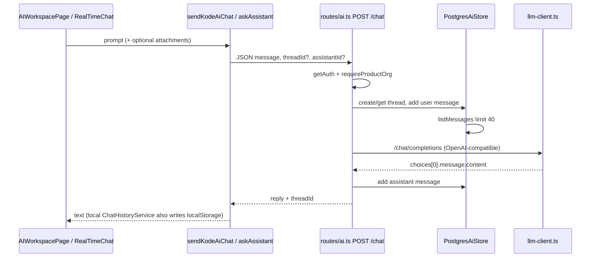
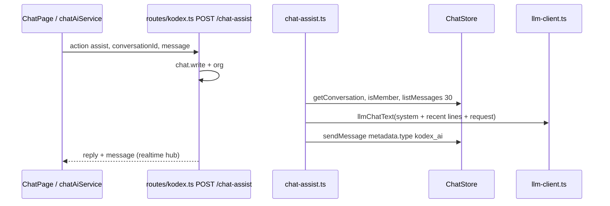
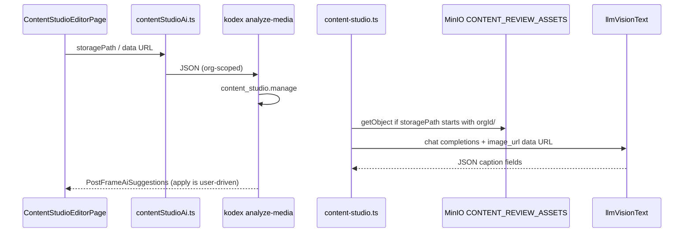
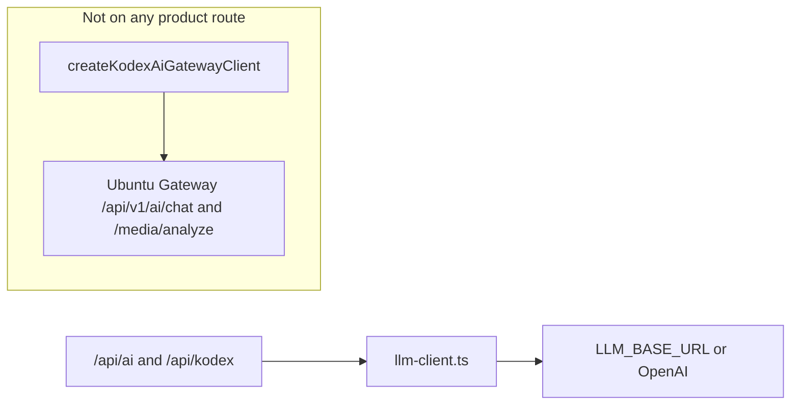

# KODEX AI workspace, pipeline and UI integration audit (sprint v0.6B)

Read-only investigation. No source, credentials, CDN, schema, or production changes. Ubuntu AI Gateway chat and vision smokes were already verified in v0.6A; this document does not repeat live inference.

## 1. Executive summary

KODEX already has **several AI surfaces**, not one. The primary product UI is **AI Workspace** (`/ai-workspace`) plus a thinner **AI Assistant** page (`/ai-assistant`), a **floating assistant**, **team-chat @kodex**, and **Content Studio caption / image analysis**. After the Kode cutover, those UIs call **kode-platform** (`/api/ai/*` and `/api/kodex/*`), which talks to an **OpenAI-compatible LLM** via `LLM_*` / `OPENAI_*` (`src/kodex/llm-client.ts`).

The Ubuntu **KODEX AI Gateway v0.4.0** client (`src/ai-gateway/*`) is **operational but unwired**. It is not imported by any application route. It is a different contract: single-turn `assistant` + `message` chat, multipart vision, structured captions with `requiresReview`, no history, no tools, no streaming.

**Do not treat the providers as interchangeable.** The smallest safe first slice is **Content Studio image analysis** behind the existing `/api/kodex/content-studio/analyze-media` route and `PostFrameAiSuggestions` UI (Option B), after a private path from the API host to the gateway exists.

## 2. Existing frontend AI architecture

### 2.1 Where the workspace lives

| Surface | Route | Gate | Primary components |
| --- | --- | --- | --- |
| AI Workspace | `/ai-workspace` | `ProtectedRoute` + `FeatureRoute feature="ai_workspace"` | `AIWorkspacePage`, `RealTimeChat` |
| AI Assistant | `/ai-assistant` | same feature flag | `AiAssistantPage`, `AiChatPanel`, `AiPromptBox`, `AiResponseCard` |
| Floating assistant | global in `App.tsx` | feature `ai_workspace` inside hook | `FloatingAiAssistant`, `useFloatingAiAssistant` |
| Team chat KODEX | chat pages | `chat.write` on API | `ChatPage`, `MessageList`, `chatAiService` |
| Content Studio AI | schedule editor | content studio feature + `content_studio.manage` | `ContentStudioEditorPage`, `SchedulePostFrame`, `PostFrameAiSuggestions` |
| AI automation review | `/ai-automation-review` | admin/IT/manager roles | `AIAutomationReviewPage` |

Navigation: `Sidebar.tsx` item **AI Workspace** → `/ai-workspace` (`featureKey: "ai_workspace"`). Duplicate `/ai-assistant` is routed but not a main sidebar pin. Dashboard uses `isEnabled("ai_workspace")`.

Exact paths:

- `ITsNomatataWorkSpace/src/app/router/AppRouter.tsx` (routes ~967–986)
- `ITsNomatataWorkSpace/src/App.tsx` (`FloatingAiAssistant`)
- `ITsNomatataWorkSpace/src/components/dashboard/components/Sidebar.tsx`
- `ITsNomatataWorkSpace/src/features/ai-workspace/pages/AIWorkspacePage.tsx`
- `ITsNomatataWorkSpace/src/features/ai-workspace/components/RealTimeChat.tsx`
- `ITsNomatataWorkSpace/src/features/ai-assistant/pages/AiAssistantPage.tsx`
- `ITsNomatataWorkSpace/src/features/ai-assistant/components/AiChatPanel.tsx`
- `ITsNomatataWorkSpace/src/features/ai-layer/components/FloatingAiAssistant.tsx`

### 2.2 Chat UI, history, loading

`RealTimeChat` owns conversation list, message list, composer, attachments, pending/error flags, and local starters. Loading is a busy/pending message pattern (not token streaming).

**UI conversation history is local.** `chatHistoryService.ts` sets `USE_REMOTE_AI_CHAT_HISTORY = false` and keys `localStorage` as `ai_workspace_local_conversations:{org}:{user}`. In parallel, `POST /api/ai/chat` **also** persists threads in Postgres `ai.chat_threads` / `ai.chat_messages`. The two stores are not the same product history.

### 2.3 Frontend API calls (observed)

| Client | Endpoint / function | Used by |
| --- | --- | --- |
| `lib/kode/ai.ts` `sendKodeAiChat` | `POST /api/ai/chat` | workspace, assistant, floating AI, router, automation |
| `lib/kode/ai.ts` assistants/threads/uploads | `/api/ai/assistants`, `/threads`, `/uploads/binary` | workspace/projects (partial) |
| `lib/kode/chat.ts` `requestKodeChatAiAssist` | `POST /api/kodex/chat-assist` | team chat @kodex |
| `lib/api/contentStudioAi.ts` | `POST /api/kodex/content-studio/generate-caption` and `analyze-media` | Content Studio when Kode is enabled |
| `lib/api/ai.ts` `askAssistant` / `analyzeImage` / `generateImage` | wraps `sendKodeAiChat` (and leftover n8n URL helpers) | workspace, assistant, stock, content fallbacks |
| `aiRouterClient.ts` `sendAiRouterMessage` | **only** `sendKodeAiChat` | workspace “tool-like” prompts |

Streaming: **not observed** on Kode AI HTTP (JSON request/response). No `text/event-stream` on `/api/ai` or `/api/kodex`.

Model/assistant selection: backend **supports** per-assistant `model` and `system_prompt` (`ai.assistants`). Workspace UI does **not** expose a first-class model picker in `AIWorkspacePage`; default system prompt is applied in the API.

Tools: `aiToolTypes.ts` lists many `AiRouterToolId` values. **Kode `/api/ai/chat` does not execute those tools.** `sendAiRouterMessage` forwards a single chat message. Treat workspace “tools” as **frontend intent routing + LLM text**, not implemented function-calling.

File upload: `uploadKodeAiFile` → `POST /api/ai/uploads/binary` (25 MiB, org-prefixed MinIO key). Workspace `RealTimeChat` also uses `ImageUploadService` / `codexAttachmentService`. Image analysis in the assistant is `analyzeImage` → `askAssistant` with an attachment (text path), **not** the Ubuntu multipart vision endpoint.

### 2.4 Team chat KODEX

- Detect: `chatAiService.isKodexMention` (`@kodex` / `@codex`)
- Call: `POST /api/kodex/chat-assist`
- Render: `MessageList.tsx` treats `metadata.type === "kodex_ai"`
- Persistence: **team chat messages table** (not `ai.chat_messages`), metadata includes `originalMessage`

## 3. Existing backend AI architecture

Mounted in `src/app.ts`:

- `api.route('/ai', createAiRoutes({ store: aiWorkspace, files }))`
- `api.route('/kodex', createKodexRoutes({ files, chat }))`

### 3.1 `/api/ai` — workspace / assistants

`src/routes/ai.ts` + `src/ai/postgres-store.ts` + `migrations/0045_ai_automation.sql`.

Auth: `getAuth` + `requireProductOrg` (**any member of the product org**). No `assertAuthorized` action such as `ai.invoke`.

Implemented: list/create/update/delete assistants; projects; threads; messages; `POST /chat`; binary upload; `GET /media` (key must start `ai/{organizationId}/`).

`POST /chat` flow:

1. Optional `assistantId` → load org-scoped assistant.
2. Create or load thread.
3. Store user message.
4. Load last 40 messages.
5. Call `llmChatCompletions` (history) or `llmChatText` (short).
6. On LLM failure, **stringifies the error into the assistant reply** (does not fail the HTTP call).
7. Store assistant message `metadata.source = 'kodex'`.
8. Return `{ reply, threadId, assistantMessage }`.

No streaming. No token usage table. No dedicated AI rate-limit policy observed on these routes (generic request middleware still applies).

### 3.2 `/api/kodex` — chat assist + Content Studio

`src/routes/kodex.ts`:

| Route | Authz | Service |
| --- | --- | --- |
| `GET /status` | `content_studio.read` | `isLlmReady()` |
| `POST /chat-assist` | `chat.write` + conversation membership | `runChatAssist` |
| `POST /content-studio/generate-caption` | `content_studio.manage` | `generateContentStudioCaption` |
| `POST /content-studio/analyze-media` | `content_studio.manage` | `analyzeContentStudioMedia` |

### 3.3 LLM provider (`src/kodex/llm-client.ts`)

OpenAI-compatible `POST {base}/chat/completions`. Config: `LLM_BASE_URL`, `LLM_API_KEY` (fallback `OPENAI_*`). `CURSOR_API_KEY` is explicitly not used.

**Implemented:** chat completions, text helper, vision via `image_url` data URLs.

**Missing vs a production gateway client:** timeouts, retries policy (none — good), structured error mapping, no 429 handling, no logging redaction of prompts (errors may include provider body text).

Prompts: inline in `chat-assist.ts` and `content-studio.ts` (not a prompt CMS).

### 3.4 Ubuntu client (unwired)

`src/ai-gateway/config.ts`, `client.ts`, `errors.ts`, `vision-response.ts`. `env.kodexAiGateway` parsed at startup, **default disabled**, **no health probe**. Callers today: tests + smoke scripts only.

## 4. End-to-end sequences (observed)

## 5. AI capability inventory

| Capability | Implemented? | Path | Ubuntu gateway today |
| --- | --- | --- | --- |
| Org-scoped workspace chat | Yes | `/api/ai/chat` | Single-turn chat only; no thread API |
| Conversation persistence (API) | Yes | `ai.chat_*` | No |
| Conversation persistence (UI) | LocalStorage | `chatHistoryService` | n/a |
| Custom assistants / system prompts | Yes (API) | `ai.assistants` | `assistant: "kodex"` only (Harold 403 by design) |
| Model picker UI | Not in workspace page | assistant.model on API | Gateway models qwen3:8b / qwen3-vl:4b, not selectable in client |
| Team chat @kodex | Yes | `/api/kodex/chat-assist` | Could wrap as one concatenated message |
| Rewrite draft | Yes | chat-assist `action=rewrite` | Same |
| Function/tools execution | **No on Kode** | frontend types only | **No** |
| Image gen | Partial / legacy | `generateImage` → `sendKodeAiChat` | **No** |
| Workspace file upload | Yes | `/api/ai/uploads/binary` | **No** |
| Vision (Content Studio) | Yes via `llmVisionText` | analyze-media | **Yes** multipart analyze |
| Caption JSON for social | Yes via LLM JSON | generate-caption + analyze | Structured captions + `requiresReview` |
| Streaming | **No** | — | **No** in v0.6A client |
| Token accounting | **No** | — | **No** |
| Dedicated AI rate limits | **Not observed** | — | 429 mapped on gateway client |
| Human apply of captions | Yes | `PostFrameAiSuggestions` | `requiresReview: true` enforced in parser |

Placeholders: n8n webhook helpers in `lib/api/ai.ts` (`VITE_N8N_AI_WEBHOOK_URL`); Supabase edge caption/analyze fallbacks in `contentStudioAi.ts` when Kode is off; `USE_REMOTE_AI_CHAT_HISTORY`; tool IDs in `aiToolTypes.ts`.

## 6. Content Studio analysis

Uploads and private media (unchanged by v0.6A): Content Studio resumable uploads → MinIO review bucket; playback via capability/HLS CDN. Analysis must not open public object URLs. `analyzeContentStudioMedia` **prefers `storagePath` starting with `{organizationId}/`**, loads bytes server-side, 12 MiB cap, image MIME only. Videos in the editor are **client-framed** to a data URL before analyze (`captureVideoFrameDataUrl`).

AI: `llmVisionText` with a long prompt demanding JSON (`mood`, `sceneDescription`, `generatedCaption`, platform captions, …). Empty strings are allowed via `pickString` (does not invent keys, but the **LLM may invent caption copy**). UI: `PostFrameAiSuggestions` shows mood/scene/caption/hashtags; user **Apply / replace / refine** — captions are editable in the post frame. Draft/review/approval remain the existing Content Studio schedule workflow, not the AI client.

**Same UI can work with Ubuntu vision** if the backend maps gateway `{ analysis, generatedCaption, requiresReview }` into `ContentStudioAnalyzeOutput` (scene → `sceneDescription`, caption → `generatedCaption` / platform captions). Missing mood/hook/hashtags must stay empty, **not fabricated**. If `requiresReview` is not true, do not treat captions as actionable (already the gateway client rule).

`generate-caption` (text-only, no image) is a **different** call (`llmChatText`). Ubuntu gateway smoke is chat + vision, not a dedicated caption JSON endpoint. Do not silently route text captioning through vision.

## 7. Current vs Ubuntu Gateway contracts

| Concern | `llm-client` / `/api/ai` / `/kodex` | Ubuntu client v0.6A |
| --- | --- | --- |
| Auth to provider | `LLM_API_KEY` Bearer | `KODEX_AI_GATEWAY_TOKEN` Bearer; `local-development` rejected |
| Chat body | OpenAI `messages[]` + `model` | `{ assistant, message }` one shot |
| History | Thread in DB + up to 40 messages | None |
| System prompt | assistant row or hardcoded KODEX/Content Studio | None (must fold into `message` if used) |
| Vision | `image_url` data URL in chat completions | `multipart` field `image`, 8 MiB |
| Vision output | Free JSON parsed loosely | Structured analysis + captions; `requiresReview` |
| Tools | Not executed | Not supported |
| Streaming | No | No |
| Timeouts | **None** on `llmFetch` | 30s chat / 60s analyze (configurable) |
| Errors | generic `Error` | typed 401/403/429/5xx/timeout/invalid + fieldPath |
| Retries | None | None |
| Default | ready if API key set | **disabled** until `KODEX_AI_GATEWAY_ENABLED=true` |
| Wired to HTTP | Yes | **No** |
| Production path | Hetzner → LLM URL | Laptop tunnel `127.0.0.1:13100` only |

## 8. Authentication and organization boundaries

**Working**

- All Kode AI routes require session auth (`getAuth`).
- AI store queries are `organization_id`-scoped.
- AI media GET requires `key` prefix `ai/{organizationId}/`.
- Content Studio analyze checks `storagePath` org prefix and uses staff `content_studio.manage`.
- Chat assist checks conversation membership.
- Gateway token is server-only; pino redacts `KODEX_AI_GATEWAY_TOKEN`.
- Caption apply in the editor is explicit user action.

**Issues (exact files)**

1. **`src/routes/ai.ts` `authorize()` = `requireProductOrg` only.** Any org member can create assistants, read threads, and invoke `/chat`. Impact: broader than Content Studio’s permission model; no separate AI quota/role.
2. **`src/routes/ai.ts` chat catch block** inserts `error.message` into the assistant reply. Impact: provider/gateway errors (and possibly prompt fragments) can surface in the UI and DB.
3. **`src/kodex/llm-client.ts`** has no timeout. Impact: hung OpenAI-compatible calls can stall the API worker (the gateway client already bounds this).
4. **`src/kodex/chat-assist.ts`** stores `originalMessage` in message metadata. Impact: extra prompt retention in team chat.
5. **Dual history** (`USE_REMOTE_AI_CHAT_HISTORY = false` vs Postgres threads). Impact: operators may think workspace history is the source of truth; it is not fully the API store.
6. **Frontend tool types vs no backend tools.** Impact: users may believe KODEX executes workspace actions; it currently only chats.
7. **Prompt injection:** workspace `buildChatInput` concatenates route/org context and attachment text into the LLM user message; chat assist concatenates last 30 chat lines. Standard LLM risk; Ubuntu single-turn chat does not add a stronger boundary.
8. **Human review gap on `llmVisionText` JSON:** no `requiresReview` flag. Ubuntu parser is stricter. Mixing providers without mapping would weaken or confuse review.
9. **Production connectivity:** Hetzner cannot use the Mac SSH tunnel. Enabling `KODEX_AI_GATEWAY_*` on the VPS without a private path would fail closed or mis-route.

Credentials were not printed or rotated in this audit.

## 9. Integration options

### Option A — Provider adapter

Put Ubuntu behind `llm-client` (`/chat/completions` shim).

- Compatibility: **low** (messages[], vision data URLs, JSON captions vs multipart/structured).
- Changes: large adapter + fake completions.
- Complexity/risk: high; easy to break workspace and Content Studio together.
- UX: unchanged if perfect; regressions likely.
- Reuse: one client, two contracts pretending to be one.
- Production: still needs private network to Ubuntu.

### Option B — Feature-specific integration (recommended first)

Keep `llm-client` for `/api/ai/chat` and caption **text** generation. Call Ubuntu only from **Content Studio analyze-media** (and optionally later chat-assist as a second slice).

- Compatibility: **high** for vision (smoke already maps analysis + caption + requiresReview).
- Changes: `content-studio.ts` + tests; maybe map fields into existing `ContentStudioAnalyzeOutput`; **no UI redesign**.
- Complexity/risk: lowest. Workspace tools/history untouched.
- UX: same `PostFrameAiSuggestions`.
- Reuse: existing gateway client as-is.
- Production: enable flag only after private connectivity.

### Option C — Full inference migration

Move workspace chat, chat-assist, captions, and vision to Ubuntu.

- Compatibility: **blocked** until gateway supports history, system prompts, tools (or KODEX drops those), and a stable caption JSON schema.
- Changes: all AI routes + frontend assumptions.
- Risk: high. Harold isolation and kodex-only assistant must stay.
- UX: possible model/quality change (qwen vs current LLM).
- Production: same connectivity plus capacity/load testing.

## 10. Recommended first integration slice (v0.6C)

**Option B, Content Studio `analyze-media` only.**

1. Server-side: if `isKodexAiGatewayConfigured(env.kodexAiGateway)`, run `analyzeImage` on org-authorized image bytes already loaded in `analyzeContentStudioMedia`; map to existing output fields; if captions present and `requiresReview !== true`, do not apply caption fields.
2. Else keep `llmVisionText` (no behavior change when gateway disabled).
3. Do not change frontend routes or `PostFrameAiSuggestions` layout.
4. Do not wire `/api/ai/chat` yet.
5. Do not deploy Ubuntu reachability to Hetzner in v0.6C unless connectivity is a separate approved task.

## 11. Files that would be modified later (not in this sprint)

- `src/kodex/content-studio.ts` — vision branch
- `src/routes/kodex.ts` — only if response envelope needs `requiresReview`
- `tests/` new kodex/content-studio gateway mapping tests
- `docs/kodex/ai-gateway-backend.md` — wired usage
- Optionally `src/kodex/chat-assist.ts` in a later slice
- **Not** `src/kodex/llm-client.ts` as a fake OpenAI shim in v0.6C
- **Not** frontend AI Workspace components for the first slice

## 12. Acceptance tests (proposed for implementation, not run as product changes here)

**Automated**

- Gateway disabled → analyze-media still uses `llmVisionText` (mock).
- Gateway enabled → bytes sent as multipart `image`; output maps `sceneDescription` / caption; empty mood/hashtags stay empty.
- `requiresReview: false` → captions not treated as actionable.
- Org `storagePath` traversal still 400.
- Logs/errors contain no token, no image bytes.

**Manual**

- Existing AI Workspace chat still replies via `/api/ai/chat`.
- @kodex in team chat unchanged.
- Content Studio editor: analyze one **non-customer test** image; suggestions appear; Apply still user-driven.
- Chat + analyze smokes against the tunnel.

## 13. Known limitations and unanswered questions

- Exact Ubuntu caption object key used in production responses (smoke succeeded with a 28-character caption; parser accepts several keys).
- Whether Ubuntu chat should receive KODEX system prompts stuffed into `message`.
- LLM production `LLM_BASE_URL` (internal vs OpenAI) was not inspected on Hetzner (forbidden).
- Image generation real backend after n8n cutover is unclear (`generateImage` still names an internal assistance action).
- No observed usage metering for either provider.
- Workspace localStorage vs `ai.chat_threads` reconciliation is unresolved product work, independent of Ubuntu.

## Files examined

**kode-platform:** `src/app.ts`, `src/routes/ai.ts`, `src/routes/kodex.ts`, `src/ai/postgres-store.ts`, `src/kodex/llm-client.ts`, `src/kodex/chat-assist.ts`, `src/kodex/content-studio.ts`, `src/ai-gateway/config.ts`, `src/ai-gateway/client.ts`, `src/ai-gateway/errors.ts`, `src/ai-gateway/vision-response.ts`, `src/config/env.ts`, `src/config/redaction.ts`, `src/products/staff.ts`, `migrations/0045_ai_automation.sql`, `docs/kodex/ai-gateway-backend.md`, `scripts/ai-gateway/smoke-chat.ts`, `scripts/ai-gateway/smoke-analyze.ts`, `tests/ai-gateway-client.test.ts`.

**ITsNomatataWorkSpace:** `AppRouter.tsx`, `App.tsx`, `Sidebar.tsx`, `AIWorkspacePage.tsx`, `RealTimeChat.tsx`, `chatHistoryService.ts`, `AiAssistantPage.tsx`, `AiChatPanel.tsx`, `aiAssistantService.ts`, `FloatingAiAssistant.tsx`, `aiRouterClient.ts`, `aiToolTypes.ts`, `lib/kode/ai.ts`, `lib/kode/enabled.ts`, `lib/kode/chat.ts`, `lib/api/ai.ts`, `lib/api/contentStudioAi.ts`, `chatAiService.ts`, `MessageList.tsx`, `PostFrameAiSuggestions.tsx`, `ContentStudioEditorPage.tsx` (analyze call site).

No customer media objects were opened. No production SSH. No dependency installs. No route or UI edits in this sprint other than adding this report file.
